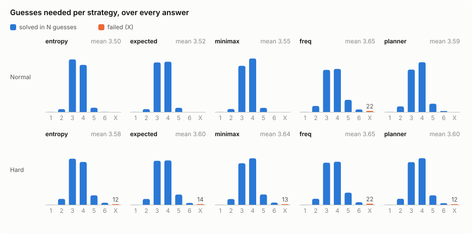
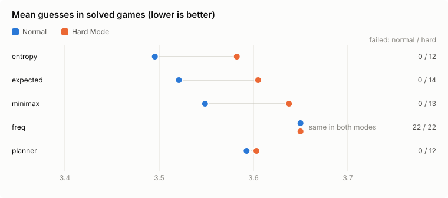
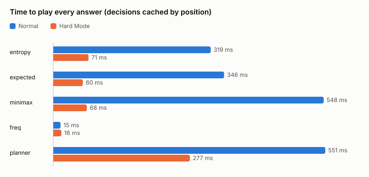

# Comparing guess strategies

This page compares five ways of choosing a guess. Each strategy plays every
one of the 2,315 answers, in normal mode and in Hard Mode, and the results
cover how many guesses it needs, how often it fails, and how long it takes.

Every number, table and chart below comes from one command, run from the
repository root:

```sh
go run ./tools/report
```

It replays every game, rewrites the generated sections of this file (between
`<!-- generated:… -->` markers), and writes [`results.json`](results.json)
and the charts in [`img/`](img). The strategies are deterministic, so
everything except the runtimes comes out the same on every machine. The
same comparison prints in the terminal with `wordle-solver bench --strategy all`.

<!-- generated:environment -->
Generated with go1.27.3 on darwin/arm64 (18 CPUs), 2315 answers, at most 6 guesses.
<!-- /generated:environment -->

## Headline

<!-- generated:headline -->
| Strategy | Mean guesses | Failed | Mean (Hard Mode) | Failed (Hard Mode) |
| --- | ---: | ---: | ---: | ---: |
| entropy | 3.495 | 0 (0.00%) | 3.582 | 12 (0.52%) |
| expected | 3.521 | 0 (0.00%) | 3.605 | 14 (0.60%) |
| minimax | 3.549 | 0 (0.00%) | 3.638 | 13 (0.56%) |
| freq | 3.650 | 22 (0.95%) | 3.650 | 22 (0.95%) |
| planner | 3.593 | 0 (0.00%) | 3.603 | 12 (0.52%) |
<!-- /generated:headline -->

"Mean guesses" averages the games that were solved; "Failed" counts games
not solved within six guesses.

## Method

**Game.** A guess earns one of 3⁵ = 243 colour patterns: green for the right
letter in the right place, yellow for a letter elsewhere in the answer, grey
otherwise, with repeated letters scored the way the game does. A game ends
when the guess is the answer or after six guesses.

**Words.** Both the possible answers and the allowed guesses are the 2,315
words of the original answer list (`internal/wordle/data/answers.txt`). The
game itself accepts about 13,000 guesses, many of them obscure. Restricting
guesses to answer words keeps every guess a real, common word, but it means
these results are not directly comparable with published optimal solvers
that use the full guess list.

**Hard Mode.** Every guess must keep each green letter in place and reuse
every revealed letter (`HardValid`). In normal mode any unplayed word may be
guessed.

**Implementation.** Before the timed runs, the benchmark computes the pattern
for every guess–answer pair once (a 2,315 × 2,315 table, about 5 MB) so that
splitting the remaining candidates is an array lookup. A strategy sees the
guesses so far and the candidates that still fit them. Strategies (a)–(d)
score every allowed guess and keep the best; ties go to a word that could
still be the answer (it might win now), then to the earlier word in the
list. Because every strategy is deterministic, the benchmark caches the
decision for each position (the sequence of guesses and patterns so far)
and reuses it in later games. The runtime is the time to play all 2,315
games with that cache, and "Positions" counts the decisions actually
computed. A test (`TestBenchmarkMatchesPlay`) checks that the cache never
changes a game.

### The strategies

With *n* candidates left, a guess splits them into groups of sizes
*n₁ … n₂₄₃*, one group per pattern.

| Name | Rule |
| --- | --- |
| (a) `entropy` | Maximise the information in the pattern, −Σ (*nᵢ*/*n*) log₂ (*nᵢ*/*n*) bits. |
| (b) `expected` | Minimise the candidates expected to remain, Σ *nᵢ*² / *n*, counting a win as none left. This is the score the human-like solver ranks guesses by. |
| (c) `minimax` | Minimise the largest group a pattern can leave; break ties by (b). |
| (d) `freq` | The classic hand heuristic: among the words that still fit, guess the one whose distinct letters appear in the most fitting words. It never looks at patterns. |
| (e) `planner` | The solver's look-ahead (`bestForThree`, `bestForTwo`). With three or more guesses left and more than three candidates, it picks, from the 8 best fitting words and the 8 best non-fitting words by (b), the guess that guarantees the most answers within three guesses. With two left, or three or fewer candidates, it maximises the answers it is sure to solve within two. Searching ahead from the first guess is too slow, so it opens with (b)'s choice. |

## Results

<!-- generated:results -->
| Strategy | Mode | Opener | Mean | 1 | 2 | 3 | 4 | 5 | 6 | Failed | Runtime | Positions |
| --- | --- | --- | ---: | ---: | ---: | ---: | ---: | ---: | ---: | ---: | ---: | ---: |
| entropy | Normal | RAISE | 3.495 | 1 | 61 | 1139 | 1020 | 92 | 2 | 0 (0.00%) | 319 ms | 2479 |
| expected | Normal | RAISE | 3.521 | 1 | 61 | 1074 | 1089 | 90 | 0 | 0 (0.00%) | 346 ms | 2494 |
| minimax | Normal | RAISE | 3.549 | 1 | 65 | 1001 | 1159 | 89 | 0 | 0 (0.00%) | 548 ms | 2504 |
| freq | Normal | ALERT | 3.650 | 1 | 130 | 912 | 933 | 262 | 55 | 22 (0.95%) | 15 ms | 2293 |
| planner | Normal | RAISE | 3.593 | 1 | 120 | 918 | 1078 | 178 | 20 | 0 (0.00%) | 551 ms | 2392 |
| entropy | Hard | RAISE | 3.582 | 1 | 127 | 998 | 928 | 205 | 44 | 12 (0.52%) | 71 ms | 2313 |
| expected | Hard | RAISE | 3.605 | 1 | 126 | 953 | 961 | 221 | 39 | 14 (0.60%) | 60 ms | 2316 |
| minimax | Hard | RAISE | 3.638 | 1 | 124 | 900 | 1007 | 223 | 47 | 13 (0.56%) | 68 ms | 2322 |
| freq | Hard | ALERT | 3.650 | 1 | 130 | 912 | 933 | 262 | 55 | 22 (0.95%) | 16 ms | 2293 |
| planner | Hard | RAISE | 3.603 | 1 | 130 | 924 | 1009 | 205 | 34 | 12 (0.52%) | 277 ms | 2306 |
<!-- /generated:results -->

Columns 1–6 count the games won in that many guesses.







### Best opener per strategy

The opener is the first guess a strategy makes from the empty position; it
is the same in both modes. The columns measure it against all 2,315 answers.

<!-- generated:openers -->
| Strategy | Opener | Entropy (bits) | Expected answers left | Worst case left |
| --- | --- | ---: | ---: | ---: |
| entropy | RAISE | 5.878 | 61.0 | 168 |
| expected | RAISE | 5.878 | 61.0 | 168 |
| minimax | RAISE | 5.878 | 61.0 | 168 |
| freq | ALERT | 5.746 | 71.6 | 196 |
| planner | RAISE | 5.878 | 61.0 | 168 |
<!-- /generated:openers -->

The three scoring rules agree on RAISE: among answer words it gives the most
information, leaves the fewest words on average and has the smallest worst
case. The letter-frequency heuristic picks ALERT, which covers common
letters but splits the answers less evenly.

### Games each strategy fails

<!-- generated:failures -->
- **freq, normal** (22): CATCH, CRACK, DADDY, FOYER, GONER, HATCH, HOLLY, JOLLY, POUND, PRIZE, RARER, SHAVE, STASH, TASTE, TATTY, TAUNT, TIGHT, VAUNT, WILLY, WITTY, WOOLY, WOUND
- **entropy, hard** (12): CRAZY, FOYER, GONER, GRAZE, MATCH, SWORE, TATTY, WASTE, WATCH, WATER, WIGHT, WILLY
- **expected, hard** (14): FOYER, GONER, GRAZE, MATCH, POUND, SHAVE, SWORE, TATTY, WASTE, WATCH, WATER, WIGHT, WILLY, WOUND
- **minimax, hard** (13): FOYER, GONER, GRAZE, MATCH, POUND, SHAPE, SHAVE, SWORE, TATTY, WASTE, WATCH, WATER, WOUND
- **freq, hard** (22): CATCH, CRACK, DADDY, FOYER, GONER, HATCH, HOLLY, JOLLY, POUND, PRIZE, RARER, SHAVE, STASH, TASTE, TATTY, TAUNT, TIGHT, VAUNT, WILLY, WITTY, WOOLY, WOUND
- **planner, hard** (12): FOYER, GONER, GRAZE, PATCH, SWORE, TIGHT, VAUNT, WASTE, WATCH, WATER, WIGHT, WOUND
<!-- /generated:failures -->

## Discussion

**Information is the best greedy rule here.** Maximising entropy gives the
lowest mean in both modes. Minimising the expected remaining words is close
behind, which is unsurprising: both reward an even split, and they differ
only in how heavily they weigh large groups. Minimax trades a little of the
mean for a guarantee about the worst case. None of the three fails in normal
mode, because each can spend a guess on a word that doesn't fit the clues
but separates the remaining candidates.

**Hard Mode removes that escape.** Every strategy that searches over guesses
fails 12–14 games in Hard Mode, and the failure lists show why: almost all
are families of words that differ in one or two letters, such as
_ATCH (MATCH, WATCH, PATCH), _OUND (POUND, WOUND), _O_ER (FOYER, GONER) and
_A_TE/_ATER (WASTE, WATER). Once the shared letters are revealed, every
legal guess must reuse them, so each guess tests only one or two new
letters. Avoiding these losses needs a different early guess, chosen with
the endgame in mind, which no one-step rule here does.

**A simple heuristic fails where the search strategies don't.** The
letter-frequency rule only ever guesses words that fit, so it plays the same
games in both modes and has no way out of a family like _ATCH; it fails 22
games (about 1%) even in normal mode. It is also by far the cheapest, since
it never computes a pattern.

**Looking ahead buys safety, not speed.** The planner maximises the answers
it is *sure* to solve within the next three guesses. That ties entropy for
the fewest Hard Mode failures (12), but in normal mode its mean is worse
than the other search strategies, with more games taking five or six
guesses. Its objective counts guaranteed wins and ignores how many guesses
a game takes, and it only considers 16 candidate guesses. That makes it a
good fit for the solver's own use, a tight guess limit (`-max`), where
finishing within the limit is all that matters.

**Cost.** With decisions cached by position, every strategy plays all 2,315
games in well under a second, computing a few thousand distinct positions.
In normal mode the three scoring rules and the planner take similar time.
In Hard Mode fewer guesses are legal after the first turn, so every search
strategy gets faster, the scoring rules much more than the planner.
Runtimes vary between machines and runs; the other numbers do not.

**Limits of this comparison.** All five strategies are greedy: they choose
one guess at a time and never search the whole game tree, so none of these
means is optimal. The guess pool is the answer list, not every allowed
word. The benchmark measures each answer once, with equal weight, which is
how the answer list was designed to be used, not how often any word has
actually been chosen.
